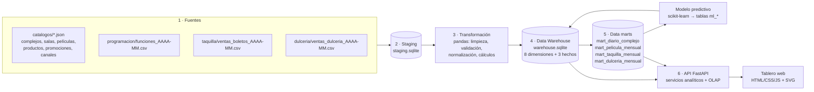
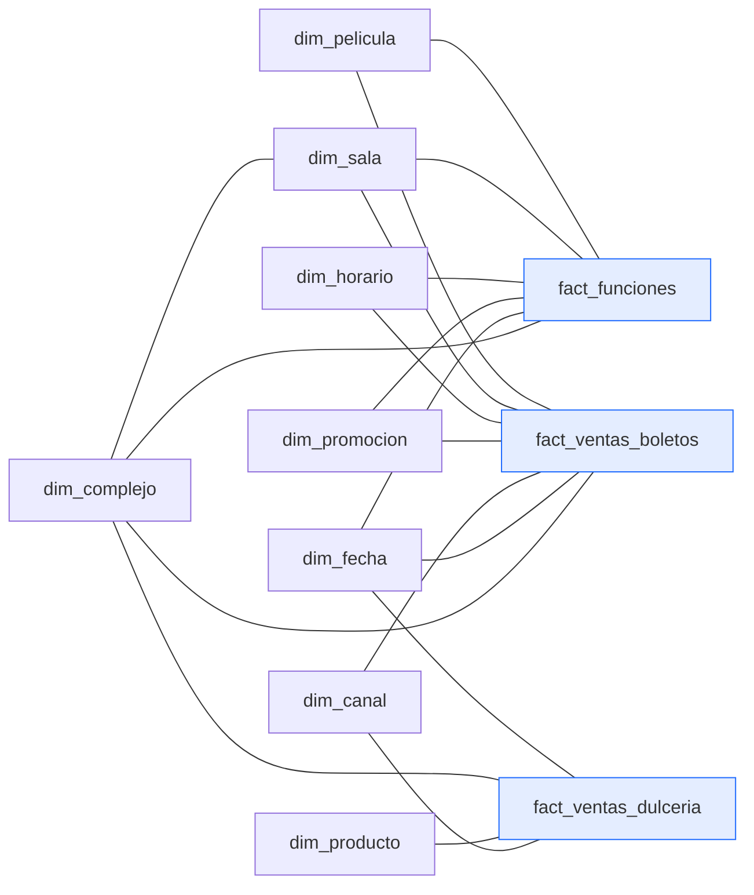
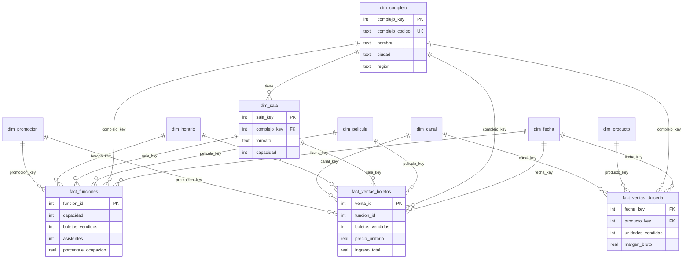

# Cine BI — Plataforma de Business Intelligence y Data Warehouse

**Materia:** Almacenes de Datos (Data Warehouse) · **Caso de estudio:** cadena cinematográfica inspirada en Cinépolis

> **Datos sintéticos para fines académicos. No representan información financiera oficial de Cinépolis.**
> Los nombres de los complejos, las películas y las distribuidoras son ficticios; las ciudades y los formatos de sala son reales. La identidad visual se inspira en el sector y no hace pasar la plataforma por un producto oficial.

Todas las cifras de este documento salen de la ejecución real del sistema (semilla `20231001`, histórico del 1-ene-2023 al 31-dic-2025). Si se vuelve a ejecutar `python run.py --setup`, se obtienen exactamente los mismos valores.

---

## 1. Descripción general del proyecto

Cine BI simula la plataforma interna de análisis de una cadena de cines. Un director de operaciones puede:

- consultar los KPI de la empresa y compararlos contra el periodo anterior;
- analizar ventas de taquilla y dulcería por fecha, ciudad, complejo, película, género, horario, canal y producto;
- hacer consultas OLAP (roll-up, drill-down, slice, dice y pivot);
- revisar un modelo predictivo entrenado con el histórico y su pronóstico a 7 y 30 días;
- leer hallazgos y recomendaciones con el indicador que respalda cada una;
- revisar la arquitectura del Data Warehouse, su diccionario de datos y la bitácora del proceso ETL.

## 2. Objetivo general

Diseñar, construir y demostrar una solución de Business Intelligence completa, con fuentes, staging, ETL, Data Warehouse dimensional, data marts, análisis OLAP, minería de datos y visualización, que convierta datos operativos de una cadena cinematográfica en conocimiento útil para tomar decisiones.

## 3. Objetivos específicos

1. Generar un conjunto de datos sintéticos coherente y reproducible: 36 meses, 14 complejos, 8 ciudades y 194 películas en catálogo, de las cuales 150 se exhiben en el periodo.
2. Diseñar un modelo dimensional en estrella con 8 dimensiones y 3 tablas de hechos, con claves sustitutas e integridad referencial.
3. Implementar un ETL que limpie, valide, normalice y cargue los datos de forma incremental e idempotente, con bitácora de ejecuciones.
4. Construir data marts agregados y un motor OLAP que elija automáticamente la tabla más pequeña capaz de responder cada consulta.
5. Entrenar y evaluar con división cronológica un modelo predictivo de ingresos diarios por complejo, y compararlo con alternativas y con una línea base.
6. Traducir los resultados en recomendaciones estratégicas fundamentadas en indicadores.

## 4. Justificación

Una cadena de cines genera millones de registros (funciones, boletos, productos) en sistemas operacionales aislados: programación, punto de venta de taquilla y punto de venta de dulcería. Esos sistemas sirven para operar, pero no para analizar: no guardan el histórico de forma integrada, sus formatos no son consistentes y sus consultas analíticas son lentas. Un Data Warehouse integra estas fuentes, garantiza la calidad de los datos y permite responder preguntas de negocio como qué complejos están cayendo, a qué hora sobran butacas o cuánto se espera vender el próximo mes.

**Datos → información → conocimiento.** En el sistema la jerarquía se observa así:
- *Dato:* una fila del POS, por ejemplo «función 2025071200231, canal App, 37 boletos, $86».
- *Información:* el resultado de agregar y relacionar datos, por ejemplo «la ocupación del turno nocturno de fin de semana fue de 40.7 % en 2025».
- *Conocimiento:* la interpretación que guía una acción, por ejemplo «sobran butacas en trasnoche entre semana y faltan en horario pico; conviene reasignar funciones».

## 5. Arquitectura de Business Intelligence

| Capa | Implementación | Archivo |
|---|---|---|
| 1. Fuentes | Generador de exportaciones operacionales simuladas, con errores intencionales | `backend/sources/generate_sources.py` |
| 2. Staging | Copia cruda (todo como texto) de cada mes extraído | `data/staging.sqlite` |
| 3. Transformación | Reglas de calidad y cálculo de métricas | `backend/etl/pipeline.py` |
| 4. Data Warehouse | Esquema en estrella en SQLite | `backend/etl/schema.sql`, `data/warehouse.sqlite` |
| 5. Data marts | Tablas agregadas que se actualizan en cada carga | `mart_*` en el mismo archivo |
| 6. BI | API REST, motor OLAP, modelo e interfaz | `backend/api`, `backend/services`, `backend/ml`, `frontend/` |

## 6. Diseño del Data Warehouse

Se eligió un **modelo dimensional en estrella** (técnicamente una *constelación de hechos*): tres tablas de hechos comparten dimensiones conformadas (`dim_fecha`, `dim_complejo`, `dim_canal`, etc.). Así una misma dimensión filtra métricas de taquilla, de funciones y de dulcería de forma consistente.

**Decisiones de modelado**

- **Claves sustitutas** (`*_key`, enteras) en todas las dimensiones, además de la clave natural (`complejo_codigo`, `sku`…) con restricción `UNIQUE`. Así el DW queda aislado de cambios en los códigos de origen. `dim_fecha` usa la clave inteligente AAAAMMDD y `dim_horario` usa HHMM, una práctica común en estas dimensiones.
- **Dimensión degenerada:** `funcion_id` vive en los hechos sin tabla propia, porque todos sus atributos ya están en otras dimensiones (sala, película, horario, fecha).
- **Sin datos dimensionales en los hechos:** los hechos sólo guardan claves y medidas; ciudad, género, formato, etc. se obtienen por *join*.
- **SCD tipo 1** en `dim_producto`: guarda el precio vigente. El precio y el costo históricos de cada venta quedan en el hecho (`precio_unitario`, `costo_unitario`), por lo que el análisis histórico no se pierde.
- **Integridad referencial** declarada con `FOREIGN KEY` y activada (`PRAGMA foreign_keys = ON`); además se verifica con `PRAGMA foreign_key_check` al final de cada carga.
- **Restricciones `CHECK`** de negocio: boletos ≤ capacidad (validado en el ETL), ocupación entre 0 y 100, cantidades positivas.

### Granularidad de las tablas de hechos

| Tabla | Grano (una fila =) | Filas | Justificación |
|---|---|---|---|
| `fact_funciones` | una función: proyección de una película en una sala, fecha y hora | 365,355 | Es la unidad mínima de oferta (capacidad) y de ocupación. |
| `fact_ventas_boletos` | los boletos de una función vendidos por un canal | 1,359,762 | Permite analizar canales y precios sin el costo de guardar cada boleto; el ticket individual no aporta información adicional al análisis. |
| `fact_ventas_dulceria` | unidades de un producto en un complejo, en un día y por un canal | 860,102 | El POS de dulcería no se relaciona con una función específica; forzar esa relación inventaría información. |

### Data marts

| Mart | Grano | Filas | Uso |
|---|---|---|---|
| `mart_diario_complejo` | complejo × día | 14,919 | KPI, series de tiempo y entrada del modelo predictivo |
| `mart_pelicula_mensual` | película × complejo × mes | 5,190 | Rankings de películas y géneros |
| `mart_taquilla_mensual` | mes × complejo × sala × canal × promoción | 29,146 | Canales, formatos y promociones |
| `mart_dulceria_mensual` | mes × complejo × producto × canal | 33,096 | Categorías, productos y márgenes |

## 7. Modelo dimensional (diagrama en estrella)

La sección **Data Warehouse** de la plataforma dibuja este mismo diagrama con los conteos reales de filas.

**Jerarquías para roll-up/drill-down:** Tiempo (año → trimestre → mes → día), Geografía (región → ciudad → complejo), Película (género → película), Producto (categoría → producto) y Horario (turno → hora).

## 8. Diccionario de datos

El diccionario completo (todas las columnas, tipos, PK/FK y descripciones) se genera en vivo desde el esquema en **Data Warehouse → Diccionario de datos**. Resumen:

| Tabla | Columnas principales |
|---|---|
| `dim_fecha` (1,461) | `fecha_key` PK AAAAMMDD, fecha, día, día de la semana, semana ISO, mes, trimestre, año, `anio_mes`, temporada (Alta/Media/Baja), vacaciones, festivo (oficial o no) y nombre del festivo |
| `dim_complejo` (14) | `complejo_key` PK, `complejo_codigo` UNIQUE, nombre ficticio, ciudad, estado, región, tipo (Premium/Tradicional), fecha de apertura, número de salas |
| `dim_sala` (91) | `sala_key` PK, `sala_codigo`, `complejo_key` FK, número, formato (Tradicional, Macro XE, IMAX, 4DX, VIP, Junior), capacidad |
| `dim_pelicula` (194) | `pelicula_key` PK, código, título, género, clasificación (AA, A, B, B15, C), duración, fecha de estreno, distribuidora, tipo de lanzamiento |
| `dim_horario` (180) | `horario_key` PK HHMM, hora, `hora_num`, turno (Matutino <14 h, Vespertino 14-18 h, Nocturno 18-22 h, Trasnoche ≥22 h), clasificación (Valle/Normal/Pico) |
| `dim_producto` (28) | `producto_key` PK, SKU, nombre, categoría (Palomitas, Bebidas, Alimentos, Dulces, Combos, VIP), precio y costo vigentes, exclusivo VIP |
| `dim_canal` (6) | Taquilla, Kiosko, Aplicación móvil, Página web, Mostrador de dulcería, Servicio en sala; tipo Presencial/Digital |
| `dim_promocion` (5) | Sin promoción, Miércoles de descuento (35 %), Matiné entre semana (20 %), Semana del cine 2024 y 2025 (50 %) |
| `fact_funciones` | FK a fecha, complejo, película, sala, horario y promoción; `semana_exhibicion`, capacidad, boletos vendidos, asistentes, asientos disponibles, % de ocupación |
| `fact_ventas_boletos` | `venta_id` PK, `funcion_id` (degenerada), 7 FK, boletos, precio unitario, descuento unitario, monto de descuento, ingreso total; `UNIQUE(funcion_id, canal_key)` |
| `fact_ventas_dulceria` | PK compuesta (fecha, complejo, producto, canal), unidades, precio y costo unitarios, ingreso total, costo total, margen bruto |
| `etl_ejecucion` | bitácora: fecha, modo, archivos, extraídos, transformados, cargados, rechazados, corregidos, estado, tiempo y detalle por fuente en JSON |
| `etl_archivo` | archivo, checksum MD5, filas, ejecución (control de la carga incremental) |
| `etl_rechazo` | ejecución, fuente, archivo, motivo y registro original rechazado |
| `ml_*` | metadatos del entrenamiento, métricas, predicciones de prueba, pronóstico e importancia de variables |

**Definición de los KPI**

| KPI | Fórmula |
|---|---|
| Ingresos totales | Σ ingreso de taquilla + Σ ingreso de dulcería |
| Boletos vendidos | Σ `boletos_vendidos` |
| Asistencia | Σ `asistentes` (boletos escaneados en el acceso; los digitales tienen ~3.5 % de inasistencia) |
| Ocupación promedio | Σ boletos / Σ capacidad (promedio ponderado, no promedio de porcentajes) |
| Ticket promedio | Ingreso de taquilla / boletos |
| Ingreso por asistente | Ingresos totales / asistentes |
| Margen bruto de dulcería | (Ingreso − costo) / ingreso |
| Variación | (actual − anterior) / anterior; en ocupación y margen se expresa en puntos porcentuales |

## 9. Diagrama entidad-relación

## 10. Diagrama del modelo en estrella

Ver la sección 7 (Mermaid) y el diagrama interactivo en **Data Warehouse** dentro de la plataforma.

## 11. Proceso ETL

**Fuente de datos (sintética).** Como no hay acceso a la base interna de Cinépolis, el generador reproduce el comportamiento de una cadena con reglas explícitas:

- *Demanda por función* = base × factor del día (lunes 0.62 … sábado 1.55) × mes (julio 1.22, septiembre 0.80) × vacaciones SEP (×1.10 y fines de semana efectivos entre semana) × festivos (×1.35 si caen entre semana) × hora (pico 19-21 h) × formato × fuerza de la película (potencial oculto × decaimiento semanal de 0.57 a 0.80 según el género) × estacionalidad del género (terror en octubre, animación en vacaciones, romance en febrero) × promoción × tendencia del complejo × ruido lognormal.
- *Ocupación* = 1 − e^(−demanda) (satura de forma natural cerca del 100 %); los *boletos* se obtienen con una binomial sobre la capacidad.
- *Programación:* cada semana, que empieza en jueves (día de estrenos), cada complejo asigna películas a sus salas; las salas grandes y premium reciben los títulos más fuertes, y las salas Junior sólo exhiben clasificaciones AA/A.
- *Canales:* la taquilla baja de 46 % a 31 % y la app sube de 28 % a 41 % entre 2023 y 2025 (digitalización gradual).
- *Dulcería:* las unidades dependen de la asistencia del día, la proporción de público familiar (más palomitas y combos), la proporción VIP (alimentos y servicio en sala), las preferencias locales y el tiempo (crecen los combos y bajan las bebidas sueltas). No hay una proporción constante.
- *Eventos de negocio simulados:* 2024 con menor oferta de estrenos (inspirado en las huelgas de Hollywood de 2023), apertura de *Complejo Juriquilla Norte* en marzo de 2024 con periodo de maduración, declive sostenido de *Complejo Azcapotzalco Norte* y remodelación de la plaza de *Complejo Cumbres* desde agosto de 2025.
- *Problemas de calidad intencionales:* duplicados, horas inválidas («25:70»), cantidades negativas, funciones inexistentes, precios vacíos, canales escritos de varias formas («APLICACIÓN MÓVIL», « Taquilla»), SKU en minúsculas, fechas en formato dd/mm/aaaa y fechas imposibles («2024-02-32»).

**Extract.** Se recorren las carpetas de fuentes y se calcula el MD5 de cada archivo. En modo incremental sólo se procesan los meses con archivos nuevos o modificados (`etl_archivo`). Los CSV se leen como texto y se copian a `staging.sqlite`.

**Transform.** Reglas por fuente:

| Regla | Funciones | Boletos | Dulcería |
|---|---|---|---|
| Duplicados exactos / de clave | rechazo | rechazo | rechazo (también tras normalizar) |
| Validación de fecha / hora | rechazo | — | dos formatos aceptados; inválidas → rechazo |
| Claves foráneas inexistentes | rechazo | función huérfana → rechazo | SKU/complejo/canal → rechazo |
| Normalización | capacidad corregida contra `dim_sala` | canal → código | SKU en mayúsculas, canal → código |
| Cantidades no válidas | — | ≤ 0 → rechazo | ≤ 0 → rechazo |
| Imputación | asistentes faltantes o > boletos → = boletos | precio vacío → precio de la misma función | precio vacío → precio de lista del año |
| Cálculos | semana de exhibición, ocupación, asientos disponibles | descuento unitario, monto de descuento, ingreso | costo (catálogo), ingreso, costo total, margen |
| Reglas de negocio | — | Σ boletos ≤ capacidad | — |

**Load.** Por cada mes, dentro de una transacción: se eliminan los hechos de ese mes, se insertan los nuevos (con FK activas) y se recalculan sus data marts. Es una operación **idempotente**: ejecutar la carga dos veces no duplica datos. Las dimensiones se cargan con *upsert* por clave natural.

**Resultados de la carga completa (ejecución #6):**

| Fuente | Extraídos | Cargados | Rechazados | Corregidos |
|---|---|---|---|---|
| Funciones | 365,447 | 365,355 | 92 | 677 |
| Ventas de boletos | 1,362,525 | 1,359,762 | 2,763 | 54,652 |
| Ventas de dulcería | 861,813 | 860,102 | 1,711 | 60,370 |
| **Total** | **2,590,123** (incl. 338 registros de catálogo) | 2,587,198 | 4,566 | 115,699 |

Tiempo: ~41 s. Motivos de rechazo: 3,187 duplicados, 436 cantidades no válidas, 398 funciones huérfanas, 195 productos inexistentes, 154 fechas inválidas, 154 unidades no válidas, 36 horas inválidas y otros.

**Reejecución.** Desde la sección **Procesos ETL** se puede ejecutar la carga incremental, reconstruir el DW completo o simular la llegada de un nuevo mes, que genera el mes siguiente, lo carga de forma incremental y reentrena el modelo. Por CLI: `python -m backend.etl.pipeline [--completa]`.

**Validaciones automáticas** (sección Data Warehouse): integridad referencial, unicidad de claves y del grano, boletos de funciones = boletos de ventas, boletos ≤ capacidad, cálculos de ocupación y margen, cuadre de cada mart con sus hechos y continuidad de la serie de tiempo. Las 12 pruebas pasan.

## 12. Tecnologías utilizadas

| Componente | Tecnología | Motivo |
|---|---|---|
| Lenguaje de backend, ETL y ML | Python 3.9 | Disponible en el equipo; ecosistema de datos |
| Manipulación de datos | pandas, NumPy | Transformaciones vectorizadas |
| Base de datos | SQLite (modo WAL) | Prototipo académico sin servidor, con FK, CHECK y upsert |
| Machine learning | scikit-learn | Ridge, Random Forest, HistGradientBoosting, permutación |
| API | FastAPI + Uvicorn | Endpoints REST tipados y documentación automática en `/docs` |
| Frontend | HTML, CSS y JavaScript (módulos ES) sin *build* | Se conservó la tecnología del proyecto original, con su paleta y su ícono |
| Gráficas | Biblioteca SVG propia (`frontend/js/charts.js`) | Sin dependencias externas: funciona sin internet durante la exposición |

**Elementos conservados del proyecto original:** paleta marino, azul y amarillo, ícono de marca, el directorio público del SIC (`data/complejos.json`, 477 complejos) con su explorador por entidad, y la etiqueta «Estado de México». La página de inicio original (`index.html`) sigue siendo la entrada del sitio en `/`: su sección «Operación modelada» ahora lee el Data Warehouse por la API, y la pestaña **Análisis BI** lista los 10 análisis y enlaza a la plataforma en `/bi`. El piloto sintético anterior (solo 2025, sin reproducir porque faltaba el CSV de origen y su base de más de 100 MB no estaba versionada) se movió a `legacy/` con su documentación.

## 13. Modelo predictivo

**Problema:** regresión supervisada. Se predice el ingreso total diario (taquilla + dulcería) de cada complejo y, con el mismo diseño, su asistencia diaria.

**Algoritmos evaluados** (todos con las mismas variables):

| Modelo | Por qué se evaluó |
|---|---|
| Línea base ingenua | Promedio del mismo día de la semana de 5 a 8 semanas atrás; cualquier modelo debe superarla |
| Regresión lineal Ridge | Modelo interpretable de referencia; regularización L2 por la colinealidad de los rezagos |
| Random Forest | Captura no linealidades e interacciones (día × vacaciones × complejo) |
| Gradient Boosting (HistGradientBoosting) | Suele ser el mejor en datos tabulares con interacciones |
| Gradient Boosting con objetivo logarítmico | El ingreso es asimétrico y multiplicativo (fin de semana × temporada × estreno); el logaritmo convierte efectos multiplicativos en aditivos y reduce el peso de días atípicos |

**Selección:** el menor MAE en **validación**. El modelo ganador fue **Gradient Boosting con objetivo logarítmico**, que también tuvo el menor MAE y MAPE en prueba. No se eligió por ser conocido, sino por su desempeño fuera de muestra.

**División cronológica** (sin mezclar el tiempo): entrenamiento del 18-feb-2023 al 19-feb-2025 (9,837 filas), validación del 20-feb-2025 al 26-jul-2025 (2,198) y prueba del 27-jul-2025 al 31-dic-2025 (2,212). Tras la evaluación, el modelo se reentrena con todo el histórico para pronosticar del 1 al 30 de enero de 2026. El intervalo del 80 % se construye con los cuantiles 10-90 de los residuos relativos en validación.

## 14. Variables utilizadas

| Grupo | Variables |
|---|---|
| Calendario | día de la semana, mes, año, semana ISO, seno/coseno del día del año, fin de semana, viernes, vacaciones, festivo, temporada alta y baja |
| Calendario de estrenos | estrenos en los últimos 7 días, blockbusters en los últimos 21 días, estrenos familiares y de terror en los últimos 21 días |
| Eventos planificados | evento promocional (semana del cine) |
| Complejo | indicadoras por complejo, número de salas, premium, días desde la apertura |
| Históricas (rezago ≥ 35 días) | ingreso hace 35, 42 y 364 días; media de 28 días; media del mismo día de la semana; asistencia, ocupación, dulcería por asistente y funciones promedio de 28 días; tendencia (media de 28 / media de 91 días) |

**Prevención de fuga de información:** ninguna variable usa datos del día que se predice ni de los 34 días previos. Por eso el modelo puede pronosticar directamente hasta 35 días sin recursividad. Tampoco se usan los boletos, las funciones programadas ni la dulcería del día objetivo. El calendario de estrenos y su tipo de lanzamiento se conocen con meses de anticipación; la fuerza real de cada película (variable oculta del simulador) **no** se expone al modelo.

## 15. Métricas de evaluación

| Métrica | Qué mide | Cómo leerla |
|---|---|---|
| MAE | Error absoluto promedio, en pesos | «En promedio me equivoco por $X al día por complejo» |
| RMSE | Raíz del error cuadrático medio | Penaliza más los errores grandes; si supera mucho al MAE, hay días con errores grandes |
| MAPE | Error porcentual medio | Se calcula sólo cuando el valor real es ≥ $1,000 para evitar divisiones cercanas a cero |
| R² | Proporción de la varianza explicada | 1 = perfecto; 0 = igual que predecir el promedio; negativo = peor que el promedio |

## 16. Resultados obtenidos

**Comparación de modelos (ingreso diario por complejo):**

| Modelo | MAE validación | MAPE validación | MAE prueba | RMSE prueba | MAPE prueba | R² prueba |
|---|---|---|---|---|---|---|
| Línea base | $73,018 | 53.3 % | $115,127 | $141,403 | 100.7 % | −0.250 |
| Ridge | $41,385 | 28.8 % | $50,440 | $68,139 | 38.8 % | 0.710 |
| Random Forest | $40,954 | 25.8 % | $52,203 | $72,790 | 33.8 % | 0.669 |
| Gradient Boosting | $39,374 | 24.8 % | $50,394 | $70,320 | 31.8 % | 0.691 |
| **GB objetivo log (seleccionado)** | **$39,144** | **24.1 %** | **$49,101** | $69,297 | **29.6 %** | 0.700 |

- **Error agregado:** semanal por complejo, MAPE 24.2 % y R² 0.695; total diario de la cadena, MAPE 24.4 % y R² 0.669.
- **Modelo de asistencia (prueba):** MAE 312 personas por día, MAPE 25.8 % y R² 0.637.
- **Variables más importantes** (aumento del MAE al permutarlas): día de la semana, número de salas, vacaciones, temporada alta, estrenos de los últimos 7 días, complejo y nivel histórico de funciones e ingreso.
- **Pronóstico** del 1 al 30 de enero de 2026: $71.0 M de ingresos totales para la cadena (−7.9 % frente al mismo periodo de 2025) y unos 447 mil asistentes.

**Indicadores de negocio de 2025** (contra 2024): ingresos totales de $909.1 M (+18.1 %), taquilla de $477.4 M (+15.1 %), dulcería de $431.6 M (+21.5 %), asistencia de 5.5 M (+9.5 %), ocupación de 27.4 % (+2.2 pp), ticket promedio de $85.65 (+4.9 %) y margen de dulcería de 76.8 %.

## 17. Interpretación de resultados

- El modelo explica cerca del **70 %** de la variación diaria y reduce el error de la línea base de 100.7 % a 29.6 % de MAPE. El R² negativo de la línea base indica que el promedio de semanas recientes es peor que no predecir nada cuando cambia la temporada.
- El error que queda es **honesto y explicable**: proviene sobre todo del éxito de cada estreno, que el simulador decide con una variable oculta y que en la realidad tampoco se conoce antes de exhibir la película. Que el MAPE de prueba (29.6 %) sea mayor que el de validación (24.1 %) muestra que el periodo de prueba (otoño-invierno, con eventos atípicos) es más difícil, no que el modelo esté sobreajustado de forma grave.
- Para decisiones de negocio conviene usar el pronóstico **agregado** (semanal o mensual), donde los errores diarios se compensan en parte.
- El sistema genera recomendaciones con el indicador que las respalda, por ejemplo: la mayor caída del segundo semestre en *Complejo Azcapotzalco Norte* (−3.3 % contra +10.6 % de la mediana de la cadena), la baja ocupación del turno trasnoche entre semana (17.1 %), la migración digital (app + web de 44.8 % a 52.9 % de los boletos), el efecto de la semana del cine (+66.5 % de asistencia diaria) y la brecha de gasto en dulcería del complejo con menor consumo por asistente. Todos los impactos se etiquetan como **estimación**.

## 18. Conclusiones

1. La arquitectura por capas (fuentes → staging → ETL → DW → marts → BI) separa responsabilidades y hace auditable cada paso: cada registro rechazado queda con su motivo.
2. El modelo en estrella con dimensiones conformadas permite cruzar taquilla, funciones y dulcería con las mismas dimensiones y responder consultas OLAP en milisegundos gracias a la navegación de agregados (data marts).
3. El ETL incremental e idempotente, con control por checksum, demuestra cómo se mantiene actualizado un almacén sin recargarlo todo ni duplicar datos.
4. El modelo predictivo, evaluado con división cronológica y sin fuga de información, supera claramente a la línea base y se reporta con sus limitaciones.
5. La capa de inteligencia de negocios convierte indicadores en acciones concretas para la dirección.

## 19. Limitaciones del proyecto

- **Los datos son sintéticos:** las reglas de simulación se basan en supuestos razonables, no en registros internos de Cinépolis. Los resultados ilustran el método y no describen la operación real.
- Se modelan 14 complejos (la cadena real tiene cientos) y un subconjunto de salas y funciones por complejo.
- El grano de boletos es función × canal, no boleto individual ni cliente; por eso no hay análisis de clientes, lealtad ni canasta por persona.
- La dulcería no se vincula con funciones ni películas, por decisión de diseño.
- En modo incremental, si se **borra** un archivo de origen, sus datos permanecen en el DW hasta una reconstrucción completa.
- SQLite es adecuado para el prototipo; un entorno productivo requeriría PostgreSQL o un DW columnar, control de concurrencia y orquestación (Airflow o similar).
- El modelo no conoce la fuerza real de cada estreno ni variables externas (competencia, clima, precios de la competencia), y el intervalo de predicción es empírico.
- La plataforma no tiene autenticación de usuarios.

## 20. Posibles mejoras futuras

- Migrar a PostgreSQL con particionamiento por fecha u orientarlo a un motor columnar (DuckDB o ClickHouse).
- Orquestar el ETL con Airflow o Prefect y agregar pruebas de calidad declarativas (Great Expectations).
- Dimensiones lentamente cambiantes tipo 2 para precios y atributos de complejos.
- Hechos a nivel de transacción y cliente (programa de lealtad) para segmentación y análisis de canasta.
- Variables externas (preventa, tráileres, redes sociales, clima) y modelos jerárquicos por complejo para mejorar el pronóstico de estrenos.
- Simulador de escenarios (precio, número de funciones y promociones) usando el modelo.
- Autenticación con roles (dirección, gerencia de complejo) y seguridad a nivel de fila.

---

### Información pública verificable usada como contexto

- Cinépolis se fundó en 1971 en Morelia, Michoacán; formatos y canales tomados de su sitio público.
- CANACINE, *Resultados de industria 2024*: taquilla nacional de 15,378 millones de pesos (−1.37 %) y 217 millones de boletos (−6.78 %). Precio promedio implícito: ~70.9 MXN.
- Directorio de complejos del Sistema de Información Cultural (SIC), descargado el 19-oct-2026 (477 complejos).

Estas cifras sólo sirven de contexto y para calibrar órdenes de magnitud (el ticket promedio simulado es de 78 a 86 MXN, con mezcla premium); no se imputan a los datos sintéticos.
